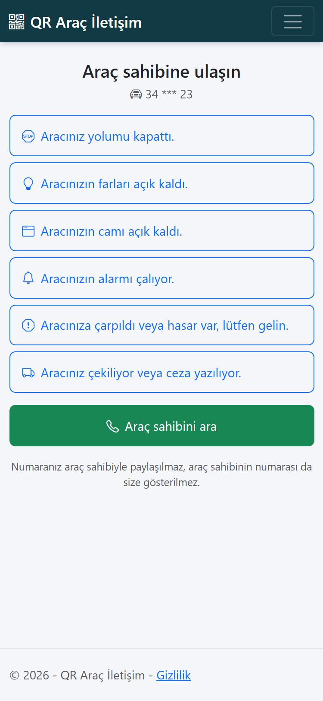
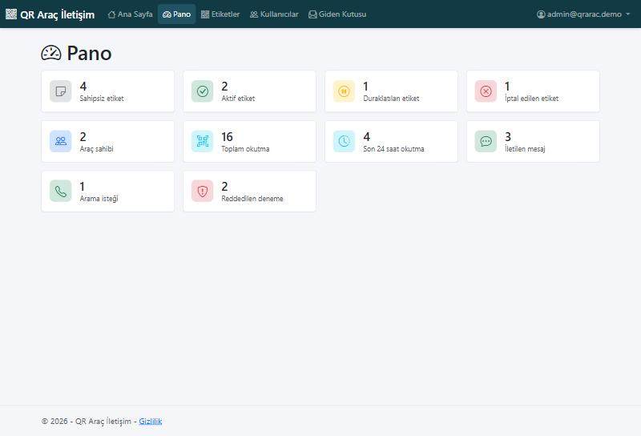
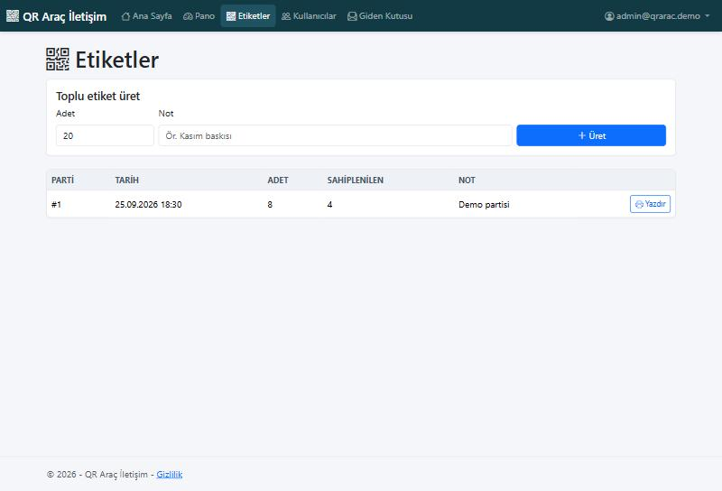
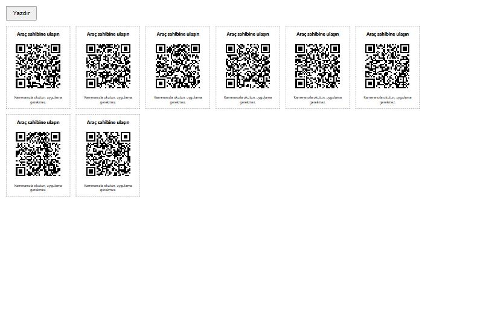
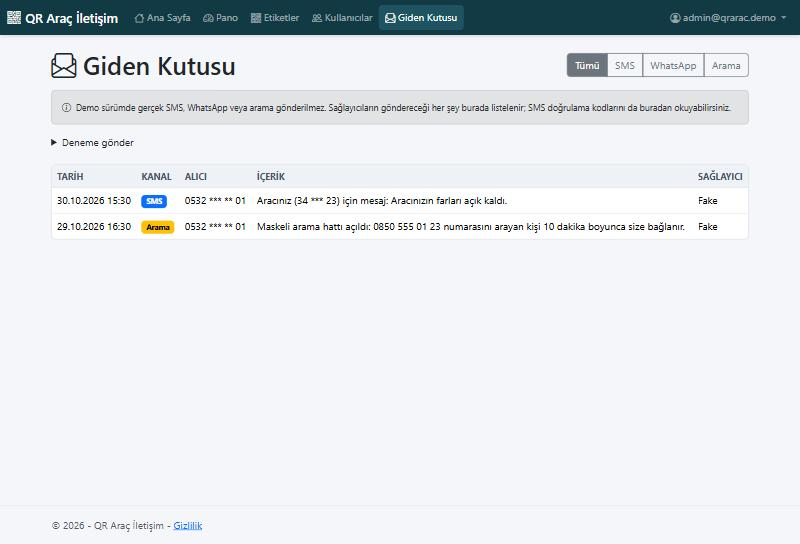
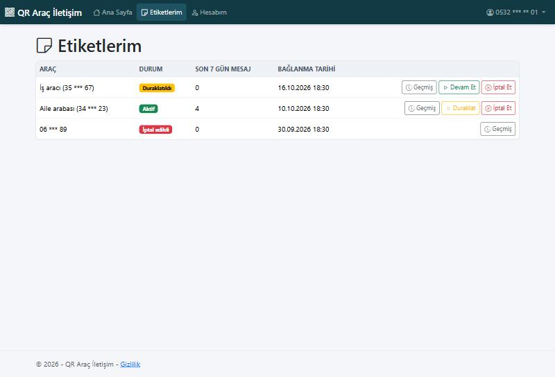
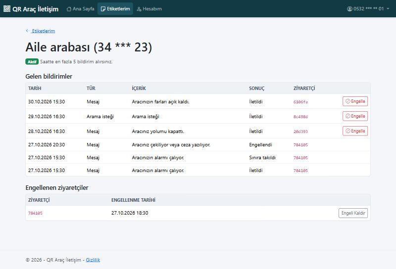

# QR Araç İletişim

[Türkçe sürüm](README.tr.md)

A QR-code vehicle contact system, built with ASP.NET Core MVC (.NET 10). Someone who finds a car blocking their way scans the sticker on the windscreen and reaches the owner in seconds, and neither side ever sees the other's phone number.

> Portfolio project. SMS, WhatsApp and call masking are paid services, so they sit behind interfaces and the whole demo runs for free on fake providers that write to an in-app outbox.



---

## How It Works

1. An admin generates a batch of stickers and prints the QR sheet.
2. The owner scans an unclaimed sticker, verifies their phone with an SMS code and links the sticker to their vehicle.
3. A visitor scans the sticker, with no app and no sign-in, and picks a preset message or asks to call.
4. The owner is notified over SMS or WhatsApp. A call request hands the visitor a temporary masked number.

## Features

### Admin
- Generate up to 500 stickers per batch, each with a 128-bit random token
- Printable A4 sheet of QR codes as sharp SVG with high error correction
- Dashboard: sticker status counts, scans, delivered messages, call requests, refused attempts
- Users list, with owners' phone numbers masked even for admins
- Outbox page showing everything the providers sent, plus a test form

### Vehicle Owner
- Register with phone number, SMS code and password, starting from an unclaimed sticker
- Pause, resume or permanently revoke a sticker
- Change the phone number with a code to the new number plus the current password
- Choose SMS or WhatsApp notifications
- See each sticker's history and block or unblock a visitor

### Public Scan Page
- Mobile-first, no sign-in, shows only a masked plate (`34 *** 23`)
- Fixed preset messages instead of free text, so it cannot carry abuse or personal data

## Spam Protection and Privacy

| Layer | Rule |
|---|---|
| Per IP, whole app | 60 scans, 10 contact attempts and 5 SMS code requests per minute |
| Per sticker | 5 delivered notifications per hour (stored per sticker) |
| Per visitor | 2-minute cooldown on the same sticker, 10 notifications per hour overall |
| Owner controls | Pause, revoke, or block one visitor on one sticker |

- SMS codes are stored only as keyed hashes, expire in 5 minutes and allow 5 wrong tries.
- One number can request 3 codes in 10 minutes. Registered numbers get a notice instead of a code and the same next screen, so the form cannot reveal who has an account.
- Visitors are stored only as a keyed hash of their IP address.
- Blocked visitors see the same message as any other refusal.

## Architecture

The app talks to outside services only through three interfaces in `Services/Providers`:

```csharp
public interface ISmsSender { Task SendAsync(string phoneNumber, string message, CancellationToken cancellationToken = default); }
public interface IWhatsAppSender { Task SendAsync(string phoneNumber, string message, CancellationToken cancellationToken = default); }
public interface ICallMaskingService { Task<MaskedCall> CreateMaskedCallAsync(string ownerPhoneNumber, TimeSpan validFor, CancellationToken cancellationToken = default); }
```

The `Providers:Mode` setting picks the implementation at startup, so controllers and services never change when the provider does.

| Mode | Implementation | Behavior |
|---|---|---|
| `Fake` (default) | `FakeProviders.cs` | Logs each message and stores it in the outbox table; nothing leaves the machine |
| `Verimor` | `VerimorProviders.cs` | Skeleton only: no network calls, each method fails on purpose until implemented |

## Switching to Verimor

The Verimor classes are a marked starting point, not a working integration. To finish it:

1. Open a Verimor account and get an approved sender name, a masking number and API credentials.
2. Implement the three classes in `VerimorProviders.cs` using Verimor's API documentation and `IHttpClientFactory`.
3. Put the credentials in environment variables (`Verimor__Username`, `Verimor__Password`, `Verimor__SourceNumber`), never in source control.
4. Set `Providers__Mode=Verimor` and test each channel from the outbox page's test form.

## Tech Stack

- **Framework:** ASP.NET Core MVC (.NET 10)
- **Database:** Entity Framework Core (Code-First) on SQL Server LocalDB
- **Authentication:** ASP.NET Core Identity with `Admin` and `Owner` roles
- **Frontend:** Razor Views, Bootstrap 5, Bootstrap Icons
- **QR codes:** QRCoder

## Getting Started

Prerequisites: the .NET 10 SDK and SQL Server LocalDB. The database is created on first start.

```bash
git clone https://github.com/kerembolek/QrAracIletisim.git
cd QrAracIletisim
dotnet run --project QrAracIletisim --launch-profile http
```

Then open http://localhost:5112.

### Demo Accounts

Created automatically in the `Development` environment. All use the password `Demo.12345`.

| Role | Sign in with | Name |
|---|---|---|
| Admin | `admin@qrarac.demo` | Demo Yönetici |
| Owner | `0532 000 00 01` | Ayşe Demir |
| Owner | `0532 000 00 02` | Mehmet Kaya |

### Demo Stickers

| Sticker | Address |
|---|---|
| Active | http://localhost:5112/s/demo-aktif |
| Paused | http://localhost:5112/s/demo-duraklatilmis |
| Revoked | http://localhost:5112/s/demo-iptal |
| Unclaimed (starts registration) | http://localhost:5112/s/demo-sahipsiz |

SMS codes appear on the admin's **Giden Kutusu** page, so you can register without a real phone.

### Before Deploying

- Set `Security__HashKey` to a long random value. The app refuses to hash without it outside Development.
- Set `PublicBaseUrl` to the public address, or printed QR codes will point at the host that generated them.
- Behind a reverse proxy, add forwarded-headers handling so limits see the real visitor IP.

## Not Included

Real provider integration, password reset, automated tests and a hosted demo are outside this MVP.

## Screenshots

| Dashboard | Sticker batches |
|---|---|
|  |  |

| Print sheet | Outbox |
|---|---|
|  |  |

| Owner's stickers | Sticker history |
|---|---|
|  |  |

## License

Source-available, not open source: you can read the code and run it on your own computer to evaluate it; company use, hosting, and distribution need written permission. See [LICENSE](LICENSE). Versions up to commit `dd32275` remain under the MIT License.
