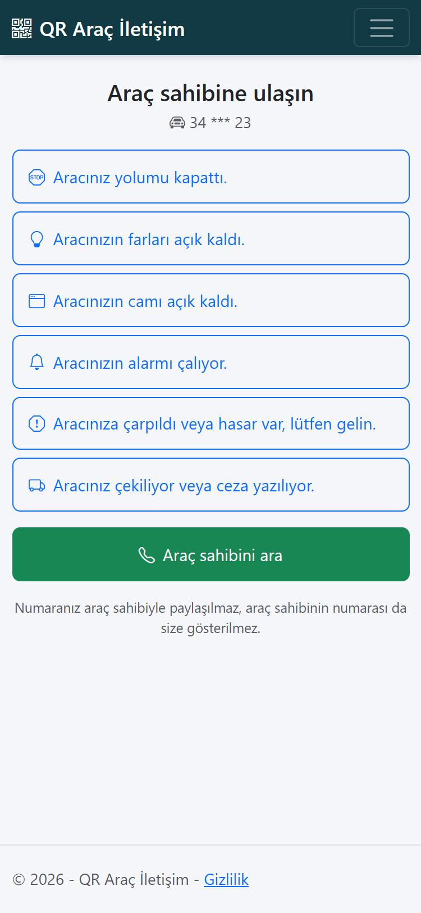
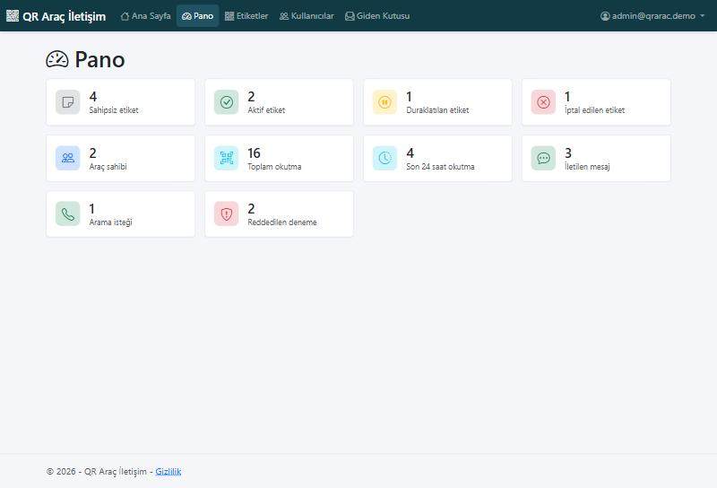
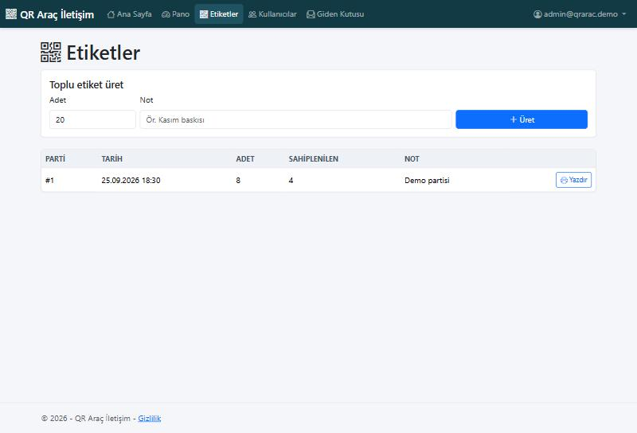
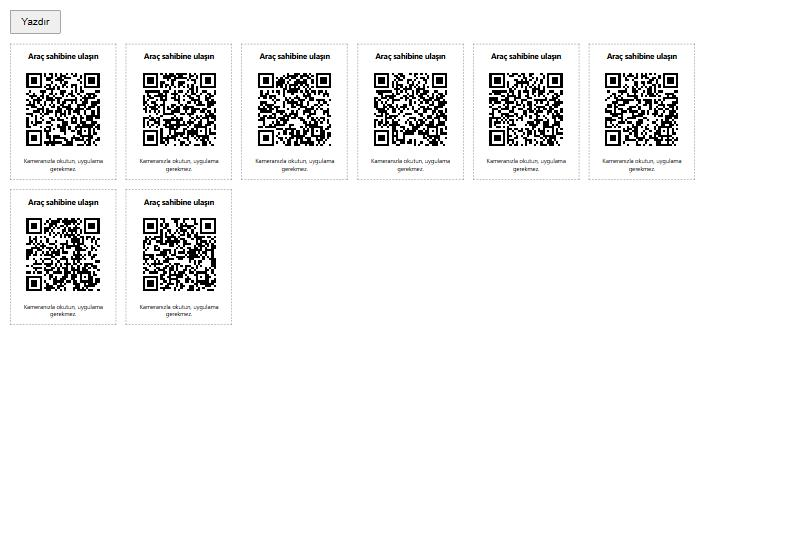
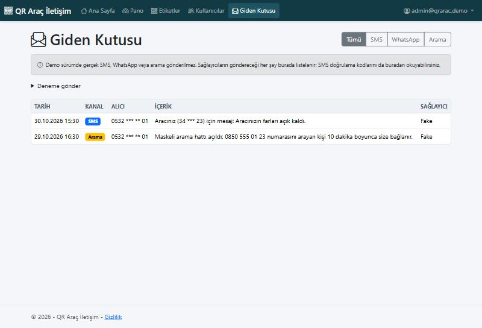
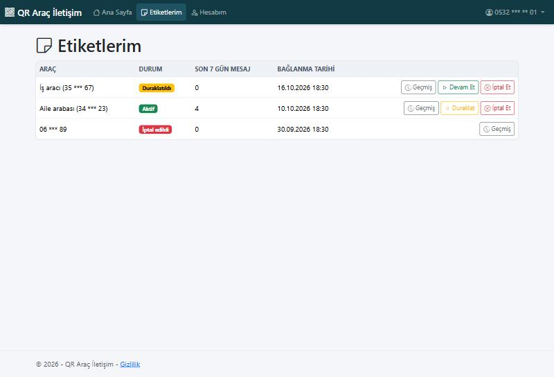
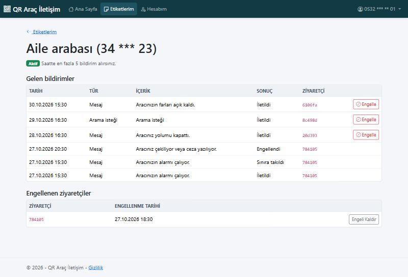

# QR Araç İletişim

[English version](README.md)

ASP.NET Core MVC (.NET 10) ile geliştirilmiş, QR kodlu araç iletişim sistemi. Yolu kapatılan biri camdaki etiketi okutur ve saniyeler içinde araç sahibine ulaşır; iki taraf da birbirinin telefon numarasını hiç görmez.

> Portföy projesidir. SMS, WhatsApp ve numara maskeleme ücretli servisler olduğu için arayüzlerin arkasında durur; demonun tamamı, mesajları uygulama içi giden kutusuna yazan sahte sağlayıcılarla ücretsiz çalışır.



---

## Nasıl Çalışır

1. Yönetici toplu etiket üretir ve QR sayfasını yazdırır.
2. Araç sahibi sahipsiz bir etiketi okutur, telefonunu SMS koduyla doğrular ve etiketi aracına bağlar.
3. Ziyaretçi etiketi okutur; uygulama yüklemeden ve giriş yapmadan hazır bir mesaj seçer ya da arama ister.
4. Araç sahibine SMS veya WhatsApp ile bildirim gider. Arama isteğinde ziyaretçiye geçici, maskeli bir numara verilir.

## Özellikler

### Yönetici
- Parti başına 500 etikete kadar üretim, her etikette 128 bit rastgele token
- Yüksek hata düzeltmeli, keskin SVG QR kodlarıyla yazdırılabilir A4 sayfası
- Pano: etiket durumları, okutmalar, iletilen mesajlar, arama istekleri, reddedilen denemeler
- Kullanıcı listesi; araç sahiplerinin numarası yöneticiye de maskeli görünür
- Sağlayıcıların gönderdiği her şeyi gösteren giden kutusu ve deneme formu

### Araç Sahibi
- Sahipsiz bir etiketten başlayarak telefon, SMS kodu ve şifreyle kayıt
- Etiketi duraklatma, devam ettirme veya kalıcı olarak iptal etme
- Yeni numaraya gelen kod ve mevcut şifreyle telefon değiştirme
- SMS veya WhatsApp bildirim tercihi
- Etiket geçmişini görme, ziyaretçi engelleme ve engel kaldırma

### Herkese Açık Okutma Sayfası
- Önce mobil tasarım, giriş gerekmez, yalnızca maskeli plaka görünür (`34 *** 23`)
- Serbest metin yerine sabit hazır mesajlar; böylece hakaret veya kişisel veri taşınamaz

## Spam Koruması ve Gizlilik

| Katman | Kural |
|---|---|
| IP başına, tüm uygulama | Dakikada 60 okutma, 10 iletişim denemesi, 5 SMS kodu isteği |
| Etiket başına | Saatte 5 iletilen bildirim (etiket bazında saklanır) |
| Ziyaretçi başına | Aynı etikete 2 dakika bekleme, toplamda saatte 10 bildirim |
| Araç sahibi | Duraklatma, iptal, bir etikette bir ziyaretçiyi engelleme |

- SMS kodları yalnızca anahtarlı hash olarak saklanır, 5 dakikada geçersiz olur ve 5 yanlış deneme hakkı vardır.
- Bir numara 10 dakikada 3 kod isteyebilir. Kayıtlı numaralara kod yerine bilgi mesajı gider ve aynı sonraki ekran gösterilir; böylece form kimin hesabı olduğunu ele vermez.
- Ziyaretçiler yalnızca IP adreslerinin anahtarlı hash'iyle tutulur.
- Engellenen ziyaretçi, diğer redlerle aynı mesajı görür.

## Mimari

Uygulama dış servislerle yalnızca `Services/Providers` içindeki üç arayüz üzerinden konuşur:

```csharp
public interface ISmsSender { Task SendAsync(string phoneNumber, string message, CancellationToken cancellationToken = default); }
public interface IWhatsAppSender { Task SendAsync(string phoneNumber, string message, CancellationToken cancellationToken = default); }
public interface ICallMaskingService { Task<MaskedCall> CreateMaskedCallAsync(string ownerPhoneNumber, TimeSpan validFor, CancellationToken cancellationToken = default); }
```

`Providers:Mode` ayarı açılışta uygulamayı seçer; sağlayıcı değişince controller ve servisler değişmez.

| Mod | Sınıflar | Davranış |
|---|---|---|
| `Fake` (varsayılan) | `FakeProviders.cs` | Her mesajı loglar ve giden kutusu tablosuna yazar; dışarı hiçbir şey çıkmaz |
| `Verimor` | `VerimorProviders.cs` | Yalnızca iskelet: ağ çağrısı yok, tamamlanana kadar her metot bilerek hata verir |

## Verimor'a Geçiş

Verimor sınıfları işaretli bir başlangıç noktasıdır, çalışan bir entegrasyon değildir. Tamamlamak için:

1. Verimor hesabı açın; onaylı gönderici adı, maskeleme numarası ve API bilgilerini alın.
2. `VerimorProviders.cs` içindeki üç sınıfı Verimor'un API belgeleri ve `IHttpClientFactory` ile yazın.
3. Bilgileri ortam değişkenlerine koyun (`Verimor__Username`, `Verimor__Password`, `Verimor__SourceNumber`), kaynak koda asla yazmayın.
4. `Providers__Mode=Verimor` ayarlayın ve her kanalı giden kutusundaki deneme formuyla test edin.

## Teknolojiler

- **Framework:** ASP.NET Core MVC (.NET 10)
- **Veritabanı:** SQL Server LocalDB üzerinde Entity Framework Core (Code-First)
- **Kimlik doğrulama:** `Admin` ve `Owner` rolleriyle ASP.NET Core Identity
- **Arayüz:** Razor Views, Bootstrap 5, Bootstrap Icons
- **QR kod:** QRCoder

## Başlangıç

Gerekenler: .NET 10 SDK ve SQL Server LocalDB. Veritabanı ilk açılışta oluşturulur.

```bash
git clone https://github.com/kerembolek/QrAracIletisim.git
cd QrAracIletisim
dotnet run --project QrAracIletisim --launch-profile http
```

Ardından http://localhost:5112 adresini açın.

### Demo Hesapları

`Development` ortamında otomatik oluşturulur. Hepsinin şifresi `Demo.12345`.

| Rol | Giriş | Ad |
|---|---|---|
| Yönetici | `admin@qrarac.demo` | Demo Yönetici |
| Araç sahibi | `0532 000 00 01` | Ayşe Demir |
| Araç sahibi | `0532 000 00 02` | Mehmet Kaya |

### Demo Etiketleri

| Etiket | Adres |
|---|---|
| Aktif | http://localhost:5112/s/demo-aktif |
| Duraklatılmış | http://localhost:5112/s/demo-duraklatilmis |
| İptal edilmiş | http://localhost:5112/s/demo-iptal |
| Sahipsiz (kaydı başlatır) | http://localhost:5112/s/demo-sahipsiz |

SMS kodları yöneticinin **Giden Kutusu** sayfasında görünür, yani gerçek telefon olmadan kayıt olabilirsiniz.

### Yayına Almadan Önce

- `Security__HashKey` değerini uzun, rastgele bir metin yapın. Development dışında bu ayar olmadan uygulama hash üretmez.
- `PublicBaseUrl` değerini herkese açık adres yapın; yoksa basılan QR kodları üretildikleri adresi gösterir.
- Ters vekil sunucu (reverse proxy) arkasında, sınırlar gerçek ziyaretçi IP'sini görsün diye forwarded headers ayarı ekleyin.

## Kapsam Dışı

Gerçek sağlayıcı entegrasyonu, şifre sıfırlama, otomatik testler ve canlı demo bu MVP'ye dahil değildir.

## Ekran Görüntüleri

| Pano | Etiket partileri |
|---|---|
|  |  |

| Yazdırma sayfası | Giden kutusu |
|---|---|
|  |  |

| Araç sahibinin etiketleri | Etiket geçmişi |
|---|---|
|  |  |

## Lisans

Kaynak kodu görünürdür ama açık kaynak değildir: kodu okuyabilir, değerlendirmek için kendi bilgisayarınızda çalıştırabilirsiniz; şirkette kullanmak, sunucuda yayınlamak veya dağıtmak yazılı izin gerektirir. Ayrıntılar [LICENSE](LICENSE) dosyasındadır. `dd32275` commit'ine kadarki sürümler MIT Lisansı altında kalır.
